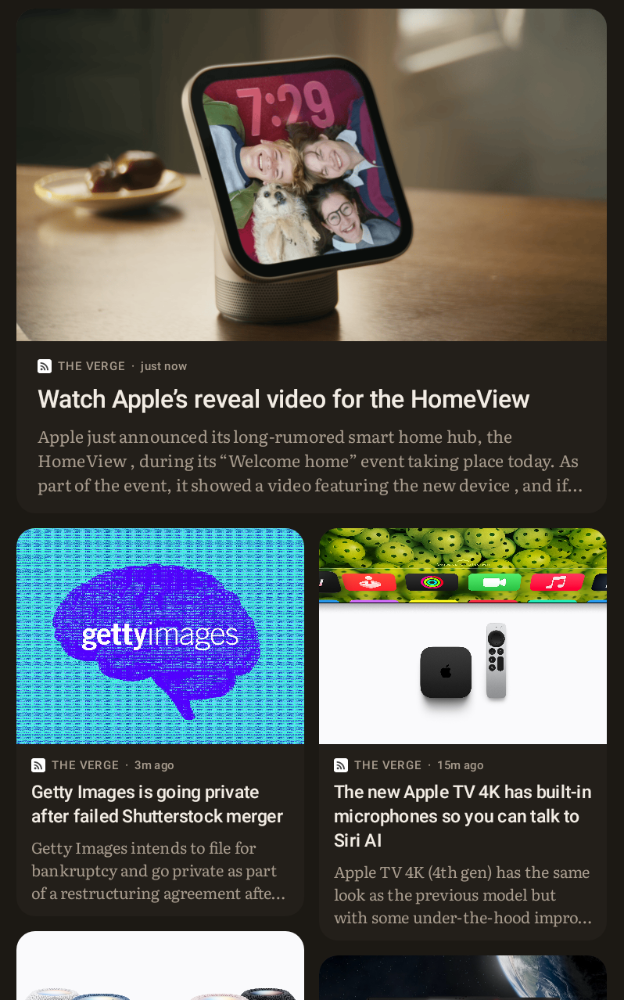
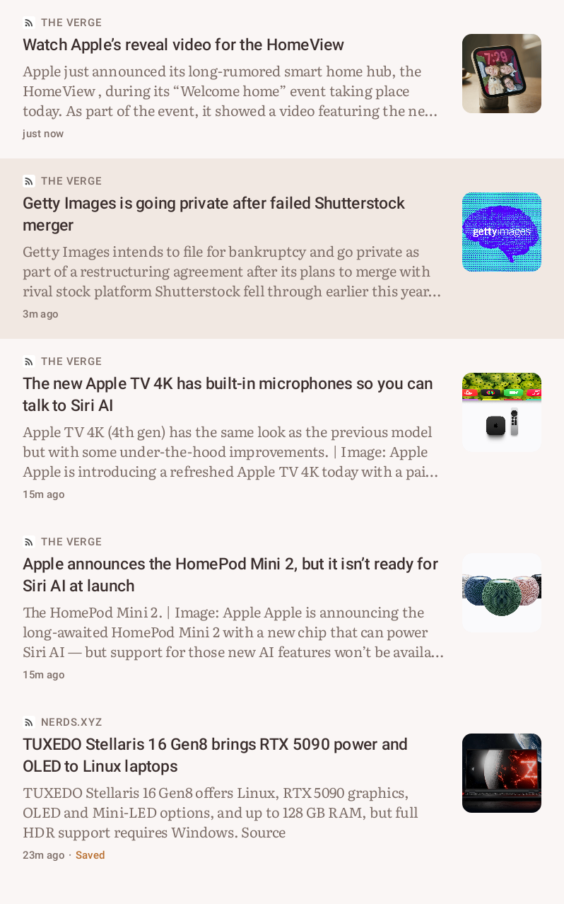

# Capy Paper

A tablet-friendly fork of Capy Reader with a warm "Paper" theme, a masonry magazine view, and three list layouts.

> [!IMPORTANT]
> Capy Paper is a personal project, provided as-is with no warranty. Use it at your own risk. Not affiliated with Capy Reader or Current.
>
> Bug reports are welcome in GitHub Issues. Fixes are best-effort, with no promised timeline. For bugs that also happen in Capy Reader, please report them upstream.

## Screenshots

  

## Credit

Capy Paper is a fork of [Capy Reader](https://github.com/jocmp/capyreader) by Josiah Campbell, licensed under GPL-3.0. Capy Paper is released under the same license. The design was inspired by the iOS reader Current.

## Install

- Download the APK from [GitHub Releases](../../releases), or
- Add this repository to [Obtainium](https://github.com/ImranR98/Obtainium) to get updates automatically.

Requires Android 11 or newer. Capy Paper uses its own app ID (`io.github.timthinks.capypaper`), so it installs alongside Capy Reader instead of replacing it.

## What changed from upstream

| Area | Change | Files |
|---|---|---|
| Theme | New default "Paper" theme: warm charcoal `#1C1914` + amber `#D3A573` (light: `#FAF6F5` + `#B86E2E`), inspired by Current | `ui/theme/colorschemes/PaperColorScheme.kt`, `preferences/ThemeOption.kt` |
| List rows | Uppercase tracked source label, semibold title, serif muted excerpt, time + amber "Saved" meta line, rounded thumbnail, no leading favicon column, wider margins | `ui/articles/ArticleRow.kt`, `ui/articles/list/ArticleListItem.kt` |
| Magazine view | Masonry grid (`LazyVerticalStaggeredGrid`); card size picked from content: FEATURE (image + long summary, full width, max one per 6 items), LARGE, PHOTO, TEXT, BRIEF. 2 columns portrait or in the two-pane list, up to 4 full-width landscape | `ui/articles/MagazineGrid.kt`, `ui/articles/ArticleList.kt` |
| Compact list | Dense rows close to stock Capy: favicon, source + age on one line, headline only (2 lines), 56dp thumbnail beside both lines, tighter padding | `ui/articles/ArticleRow.kt` (`CompactArticleListItem`), `ui/articles/list/ArticleListItem.kt` (`compact`) |
| Layout menu | Top-bar menu picks List / Compact / Magazine (global preference `article_list_layout`, default Magazine). Search results use List or Compact; Magazine falls back to List when mark-read-on-scroll is on | `ui/articles/list/ArticleListTopBar.kt`, `preferences/ArticleListLayout.kt` |
| Reader | Literata serif body + titles by default; amber dot + uppercase source above the headline; links use the amber accent | `ui/articles/reader/ArticleHeader.kt`, `preferences/AppPreferences.kt` |
| Unread counts | Hidden by default | `preferences/BadgeStyle.kt` |
| FreshRSS icons | Feed icons served by FreshRSS (`f.php`) are rebased onto the address the account syncs with, so they load even when FreshRSS's configured base URL differs | `capy/.../accounts/reader/FreshRSSIconURL.kt`, `ReaderAccountDelegate.kt` |
| App identity | Display name "Capy Paper", app ID `io.github.timthinks.capypaper` for the `free` flavor | `app/build.gradle.kts`, `res/values/strings.xml` |

Paths are under `app/src/main/java/com/capyreader/app/` unless noted.

## Build

Open the project in Android Studio, or build from the command line with JDK 21 and the Android SDK:

```bash
./gradlew assembleFreeRelease   # needs your own release keystore and secrets.properties to sign
./gradlew assembleFreeDebug     # debug build, no release keystore needed
```

## Screenshot tests

`TabletScreenshotTest` renders the magazine and list layouts at tablet sizes with Robolectric + Roborazzi, so layouts can be reviewed without a device. Its fixtures (`app/src/test/resources/screenshot-fixtures/`) are not included in this repository, and the test skips when they are absent. Output goes to `screenshots/`.

```bash
./gradlew :app:testFreeDebugUnitTest --tests 'com.capyreader.app.ui.articles.TabletScreenshotTest'
```

## Syncing upstream

Add Capy Reader as a remote and merge its `main`:

```bash
git remote add upstream https://github.com/jocmp/capyreader.git
git fetch upstream && git merge upstream/main
```

Conflicts usually land in `ArticleRow.kt` and `ArticleList.kt`.

---

# Capy Reader


_A smallish RSS reader with support for Feedbin, FreshRSS, Miniflux and local feeds._

 <a href="https://hosted.weblate.org/engage/capy-reader/">
 
</a>

## Download

- [Google Play][gplay_link]
- [F-Droid][fdroid_link]
- [IzzyOnDroid][izzy_link]
- [GitHub Releases][github_link]

Capy Reader is free across all sources. It is available for devices running Android 11 or later.

### Releases

- Google Play and F-Droid releases happen every week or so depending on new features, bugfixes and translations.
- Nightly releases are a separate package marked with a "-nightly" suffix. These are unstable, untested builds.

## Reporting a bug

Bug reports are always welcome and are a top priority. Please search the [discussions](https://github.com/jocmp/capyreader/discussions) first and issues to make sure the bug is new and hasn't been reported yet.

If you're in doubt or run into an unreported issue, go ahead and submit a bug report. Please include details like app version, OS version, and steps to reproduce the bug. Screenshots are also useful!

[Report a bug](https://github.com/jocmp/capyreader/discussions/new?category=bugs)

## Feature Requests

If you have questions or a general feature request, please post them to discussions as a [feature request](https://github.com/jocmp/capyreader/discussions/new?category=feature-requests).

### Full Content Support

Sometimes Capy's full content mode doesn't work as expected on a site due to the chaos of the web.

When this happens, please submit a separate issue to support full content for that site: [Full Content Request form](https://github.com/jocmp/capyreader/discussions/categories/full-content-request)

Writing and verifying full content parsers can be time consuming. If you find this useful, [consider donating](https://ko-fi.com/capyreader) to show your support.

## Roadmap

Check out the [project roadmap](https://github.com/users/jocmp/projects/3) to see what's currently in progress and on deck.

## Contributing

### Translations

Translations are hosted on [Weblate](https://hosted.weblate.org/projects/capy-reader) and are open to everyone to add or update translations. If you don't see your language, feel free to add it!

### Pull Requests

If you want to create a pull request **please ask first.** This will save time in review, and save your time writing code if it doesn't fit for the app.

## Building the app

### Getting Started

1. Clone this repository
2. Install [Android Studio](https://developer.android.com/studio) if you don't have it already
3. Sync Gradle
4. In the toolbar, go to Run > Run 'app'

#### Build a signed release (Optional)

By default the app will build with a debug keystore. Follow the instructions below to build a signed release.

1. Ensure you have a keystore with the name `release.keystore` in the root directory.
2. Next, create a file called `secrets.properties`, also in the root directory, with the following values

    ```properties
    key_alias=
    store_password=
    key_password=
    ```


[gplay_link]: https://play.google.com/store/apps/details?id=com.capyreader.app
[fdroid_link]: https://f-droid.org/packages/com.capyreader.app/
[izzy_link]: https://apt.izzysoft.de/fdroid/index/apk/com.capyreader.app
[izzy_img]: https://img.shields.io/endpoint?url=https://apt.izzysoft.de/fdroid/api/v1/shield/com.capyreader.app&label=IzzyOnDroid
[github_link]: https://github.com/jocmp/capyreader/releases/latest
[github_img]: https://img.shields.io/github/v/release/jocmp/capyreader?logo=GitHub
